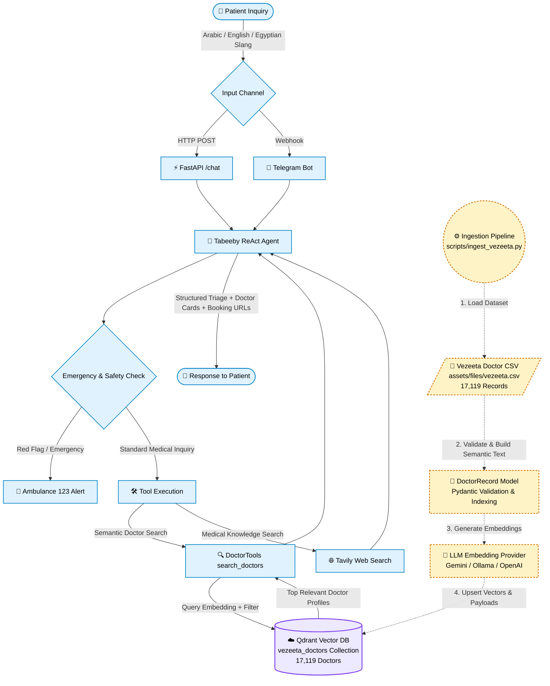

# 🩺 Tabeeby Agent (طبيبي) — Autonomous AI Medical Assistant & Doctor Finder

<p align="center">
  
  
  
  
  
  
</p>

---

## 🌟 Live Demo & Deployment

| Platform | Deployment Details | Link |
| :--- | :--- | :--- |
| **🤖 Telegram Bot** | Live Bot on **FastAPI Cloud** + **Qdrant Cloud** | 👉 [**@tabeeby_bot on Telegram**](https://t.me/tabeeby_bot) |
| **⚡ REST API Docs** | Live FastAPI Interactive Swagger / OpenAPI UI | 👉 [**https://tabeeby-agent.fastapicloud.dev/docs**](https://tabeeby-agent.fastapicloud.dev/docs) |

---


## 📌 Overview

**Tabeeby (طبيبي)** is an autonomous AI Medical Healthcare Navigator designed specifically for Egyptian and Middle Eastern healthcare contexts. Powered by the **Vezeeta** medical catalog of **17,000+ registered doctors**, Tabeeby bridges the gap between patient complaints (in English, Modern Standard Arabic, or Egyptian colloquial Arabic/slang) and verified specialist doctors.

### ✨ Key Capabilities
* **🧠 Smart Clinical Triage**: Intelligently deduces the required medical specialty (e.g. `"ضرس بيوجعني"` $\to$ **Dentistry**, `"وجع شديد في الصدر"` $\to$ **Cardiology**, `"تأخر حمل"` $\to$ **Reproductive Medicine & Infertility**).
* **🔍 Hybrid Vector Similarity & Metadata Filtering**: Embeds clinical features (**Specialty, Subspecialties, Symptoms, Title, and Medical Background**) into dense semantic vectors indexed in **Qdrant** (`vezeeta_doctors` collection), coupled with deterministic payload filtering on **Location/Area** and **Consultation Fee**.
* **🚑 Emergency Red Flag Protocols**: Instantly detects acute life-threatening symptoms (stroke, crushing chest pain, severe hemorrhage) and directs patients to emergency medical services (**Dial 123 in Egypt**).
* **🔗 Direct Booking Links**: Recommends verified doctors with direct Vezeeta booking URLs, fees in EGP, ratings, and exact clinic addresses.
* **🌐 Medical Web Search**: Leverages Tavily API for supplementary clinical lookups, rare condition explanations, and drug interaction inquiries.
* **💬 Omnichannel Availability**: Accessible via high-performance **FastAPI REST API** and interactive **Telegram Webhook Bot**.
* **🧠 Skills (progressive disclosure)**: 7 medical skills (`skills/*/SKILL.md`) — emergency triage, doctor finder, Egyptian Arabic, medication info, lab results, pediatrics, mental health — loaded only when needed.
* **🔌 MCP, both ways**: Tabeeby **is** an MCP server (`/mcp`, or stdio for Claude Desktop/Cursor) and can **borrow** tools from any external MCP server.
* **🔁 Reliable goal loop**: per-message budget (steps, seconds, tool actions, USD), stuck-loop detection, and **self-verification in code** (grounded links, emergency number, language) with automatic refine → repair.
* **📏 Evaluation**: 32 offline tests + a live eval set scored by code (11/11 passing) + a skill trigger bench.

---

## 🏗️ Architecture & Workflow

The system is architected into two decoupled subsystems:
1. **Offline Ingestion Pipeline (Separate Process)**: A standalone ETL batch pipeline that cleans, validates, embeds, and indexes doctor records into Qdrant (`vezeeta_doctors`). It runs independently on demand, during setup, or via scheduled jobs without affecting server uptime.
2. **Online Runtime Agent (FastAPI / Telegram)**: An autonomous ReAct reasoning agent that parses patient inquiries, performs clinical triage, executes vector search and web search tools, and formats grounded recommendations.



---

## 📂 Project Structure

```text
Tabeeby-Agent/
├── README.md
├── docs/
│   ├── tabeeby_report.tex           # LaTeX report: what was added & why (build: make docs)
│   └── tabeeby_report.pdf
└── src/
    ├── app.py                       # FastAPI app factory: /chat, /telegram, /mcp, /health, /skills, /tools
    ├── environment.yml              # conda env (local dev)
    ├── pyproject.toml / uv.lock     # dependencies (FastAPI Cloud installs from uv.lock)
    ├── Makefile                     # make app | test | eval | mcp | telegram | deploy ...
    ├── agent/
    │   ├── agent.py                 # goal loop: skills + MCP tools + budget + verify→refine→repair
    │   ├── budget.py                # steps / seconds / actions / USD budget
    │   ├── safety.py                # deterministic red-flag detector (EN + Egyptian Arabic)
    │   └── verifiers.py             # code verifiers + deterministic repair
    ├── skills/                      # SKILL.md recipes (+ references/) — no Python needed
    ├── mcp_server/                  # Tabeeby as an MCP server (tools, resources, prompts)
    ├── stores/
    │   ├── llm/                     # Gemini / OpenAI / Groq / Ollama providers (+ retry/backoff)
    │   ├── mcp/                     # MCP client: borrow tools from external servers
    │   └── vectordb/                # Qdrant provider & filter builder
    ├── tools/
    │   ├── search_doctors.py        # hybrid search with normalised filters + graceful relaxation
    │   ├── catalog.py               # area / specialty normaliser (aliases, Arabic, fuzzy)
    │   ├── skills.py                # SkillLibrary: load_skill / read_skill_reference
    │   └── web_tools.py             # Tavily medical web search
    ├── telegram_bot/                # shared Telegram handler (webhook + polling), formatting
    ├── routes/                      # chat, telegram webhook, info endpoints
    ├── helpers/                     # config, bootstrap, session store
    ├── evals/                       # live eval set + runner + skill trigger bench
    ├── tests/                       # offline pytest suite (fake LLM, no keys needed)
    └── scripts/                     # ingestion, telegram polling, vector check, cloud env push
```

---

## ⚙️ Prerequisites & Requirements

* **Python** `3.10+` managed with **conda** (Miniconda/Anaconda)
* **Vector Database**: [Qdrant Cloud](https://cloud.qdrant.io) cluster or local embedded Qdrant
* **LLM & Embeddings**: Gemini (default), OpenAI, **Groq** (generation only) or Ollama
* Optional: Tavily (web search), a Telegram bot token, a FastAPI Cloud account

---

## 🚀 Quickstart (conda)

```bash
git clone https://github.com/amr10w/Tabeeby-Agent.git
cd Tabeeby-Agent/src
conda env create -f environment.yml        # or: make env
conda activate tabeeby-agent
cp .env.example .env                       # then fill in your keys
make test                                  # 32 offline tests, no keys needed
make app                                   # http://127.0.0.1:8000/docs
```

All `make` targets run inside the `tabeeby-agent` conda env (`conda run -n tabeeby-agent ...`).
See `src/.env.example` for every setting (budget, skills, MCP, Telegram secret, sessions).

---

## 🗄️ Offline Data Ingestion & Indexing (Separate Process)

> [!WARNING]
> The vectors in Qdrant **must** be produced by the same embedding model the app queries with.
> Check it any time with `make check-vectors` (mean cosine should be ~1.0).

```bash
make ingest            # full rebuild (drops and recreates the collection)
make ingest_default    # incremental
python -m scripts.ingest_vezeeta --batch-size 64 --reset --verbose
```

| Argument | Default | Description |
| :--- | :--- | :--- |
| `--batch-size` | `64` | Records per embedding and insertion batch. |
| `--reset` | `False` | Drops and recreates the collection before ingesting. |
| `--verbose` | `False` | `DEBUG` logging. |

---

## 📡 API

| Method | Path | Purpose |
| :--- | :--- | :--- |
| `POST` | `/chat` | Ask the agent. Optional `session_id` (server remembers the chat) and `include_trace` |
| `DELETE` | `/chat/{session_id}` | Forget a session |
| `POST` | `/telegram/webhook` | Telegram updates (secret-token protected) |
| `*` | `/mcp/` | Tabeeby MCP server (streamable HTTP, `Authorization: Bearer $MCP_API_KEY`) |
| `GET` | `/health` | LLM, Qdrant, skills, MCP, Telegram status |
| `GET` | `/skills`, `/skills/{name}` | Skill menu / one skill's instructions |
| `GET` | `/tools` | Tools, per-message budget and verifiers |

```bash
curl -X POST http://127.0.0.1:8000/chat -H 'Content-Type: application/json' -d '{
  "prompt": "ضرسي بيوجعني جامد وانا في المعادي، ميزانيتي 400",
  "session_id": "demo-1",
  "include_trace": true
}'
```

The response contains `response`, `stop_reason` (e.g. `completed`, `verified after 1 refinement(s)`),
`verified`, `emergency`, `total_cost` and — with `include_trace` — the tool calls, skills used,
verification checks and budget usage.

---

## 🧠 Skills

A tool is an appliance; a skill is a recipe. The agent always sees the skill **menu** (name +
description), calls `load_skill(name)` for the body, and `read_skill_reference(skill, file)` for
reference files the body points to. Add a skill by creating `src/skills/<name>/SKILL.md` — no Python.
Check that the right skill fires with `make bench`.

## 🔌 MCP

**Tabeeby as a server** — tools `search_doctors`, `check_emergency`, `medical_web_search`,
`list_specialties`, `list_areas`, `ask_tabeeby`; resources `tabeeby://emergency-numbers`,
`tabeeby://skills`, `tabeeby://skills/{name}`; prompt `triage`.

```jsonc
// Claude Desktop: claude_desktop_config.json
{ "mcpServers": { "tabeeby": {
    "command": "/home/<you>/miniconda3/envs/tabeeby-agent/bin/python",
    "args": ["/path/to/Tabeeby-Agent/src/mcp_server/__main__.py"] } } }
```

Remote clients connect to `https://<your-app>.fastapicloud.dev/mcp/` with the bearer key.

**Tabeeby as a client** — set `MCP_SERVERS` (JSON) and the agent borrows those tools as
`<server>__<tool>`; a server that fails to start is skipped, never fatal.

## 🔁 Reliable loop & 📏 evaluation

Every patient message runs inside a **budget** (default 8 steps, 90 s, 12 tool calls, optional USD cap).
Tools are refused on the last step / last 25% of the time so the model always writes an answer;
a tool that fails twice is disabled and duplicate calls are skipped. Every final answer passes **code
verifiers** — grounded Vezeeta links, booking links present, emergency number for red flags, answer
language — and failures are fed back for a refinement; if the budget ends first a deterministic repair
removes unverified links and prepends the emergency banner.

```bash
make test     # offline unit/integration tests (fake LLM)
make eval     # live: real LLM + Qdrant, 11 cases scored by code, JSON report in evals/reports/
make bench    # live: did the right skill fire?
```

---

## 🤖 Telegram Bot

Commands: `/start`, `/help`, `/reset`, `/emergency`, `/skills`. Long answers are split under
Telegram's 4096-character limit and Markdown is converted to Telegram HTML.

* **Local** (no public URL): `make telegram` — long polling; removes the webhook while running.
* **Production**: set `TELEGRAM_WEBHOOK_URL=https://<your-app>.fastapicloud.dev/telegram/webhook`
  and `TELEGRAM_WEBHOOK_SECRET`; the app registers the webhook (with the secret) on startup.

## ☁️ Deploy to FastAPI Cloud

```bash
cd src && conda activate tabeeby-agent
fastapi login
make lock          # only if you changed pyproject.toml
fastapi deploy     # first deploy creates/links the app (entrypoint: app:app from pyproject)
make cloud-env     # pushes .env to FastAPI Cloud (keys/tokens as secrets)
fastapi deploy     # redeploy so the new env vars are used
```

---

## 🛡️ Medical Disclaimer & Safety Protocols

> [!IMPORTANT]
> **Tabeeby is an AI-powered clinical navigation and doctor discovery assistant, NOT a licensed physician.**
> * It does **not** provide definitive clinical diagnoses or prescribe controlled pharmaceutical medications.
> * If experiencing emergency red flags (severe chest pain, difficulty breathing, stroke symptoms, major trauma, uncontrolled bleeding), patients are instructed to immediately dial **123 (Ambulance in Egypt)** or visit the nearest emergency room.

---

## 📄 License & Author

* **Author**: Amr Walid ([@amr10w](https://github.com/amr10w)) — [amrw5189@gmail.com](mailto:amrw5189@gmail.com)
* **Dataset & Source**: Vezeeta Egypt Medical Directory
* **License**: MIT License
